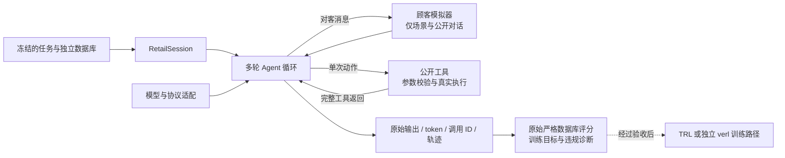

<div align="center">

# RetailAgent-RL

**面向电商售后业务的多轮 Agent 评测与后训练实验项目**

让模型通过真实工具完成订单操作，并保留从顾客要求到最终数据库状态的完整证据。

[](pyproject.toml)
[](LICENSE)
[](#当前状态)
[](https://huggingface.co/datasets/Eternity5551/retail-agent-rl-artifacts)

[快速开始](#快速开始) · [架构](#架构与数据流) · [实验结果](#已验证的结果) · [代码阅读](#代码阅读路线) · [已知限制](#已知限制与下一步)

</div>

## 项目在做什么

RetailAgent-RL 围绕 **SFT → 多轮采样 → 工具执行 → 业务判分 → GRPO** 建立可检查的实验链路。业务环境和政策复用固定版本的 tau2-bench，数据来自 AReaL-tau2-data；项目自己的工作集中在数据复核、交互协议、轨迹记录、训练适配与结果诊断。

支持取消订单、退货、换货、修改订单地址、修改商品选项、修改付款方式、修改用户默认地址七类写操作，以及跨订单的复合任务。运行中的客服使用英文，项目说明使用中文。

**当前发布的是开发快照。** 近期主线是将社区 4B 检查点接入原 Retail 环境，完成真实顾客交互与原评分复核。社区模型已经经过上游 GRPO；本项目的这批成绩来自评测，没有对该模型再次训练，也不代表复现了它的上游训练。

## 当前状态

| 路径 | 已完成 | 边界 |
|---|---|---|
| 数据与环境 | 冻结来源、联合划分、原始 RL 任务重放、独立数据库与工具参数校验 | 离线可执行不保证自然语言任务与单一金标准一致 |
| 原 Qwen3-4B SFT | 已有 711 步 QLoRA 成果；保留适配器与训练元数据 | 历史结果不能直接当作当前社区模型的对照 |
| 原 TRL GRPO | 有 CUDA smoke、两步更新及重载的历史验收记录 | 不等于完成全池训练或证明业务能力提升 |
| verl 迁移 | 独立同步入口、Retail AgentLoop、token/mask、概率与 checkpoint 审计代码 | 真实显存改善、完整训练及吞吐收益仍待验收 |
| 社区模型评测 | retail_174 四条轨迹；另选四个 TRAIN 任务，各四条轨迹 | 小样本 TRAIN 诊断，不是留出测试成绩 |
| 当前待处理 | retail_135 场景/库存/参考操作冲突与工具缺陷；retail_136 支付选择与严格参考不一致 | 本次发布保留原代码和原评分，尚未修复或重标分 |

## 架构与数据流



- **状态隔离**：每条轨迹创建自己的 RetailSession，数据库从固定快照复制。
- **信息隔离**：客服只能看到公开政策、工具定义和实际历史；隐藏顾客场景与金标准不进入客服提示词。
- **可追溯执行**：保留模型原始输出、完整工具返回、唯一调用 ID、最终评分；基础设施异常与业务失败分别记录。
- **损失边界**：训练路径只对客服生成 token 计算策略损失；顾客和工具输出仍作为上下文。
- **协议分开**：原 Qwen/SFT、MMOPD 和社区单动作实验使用各自入口，不能仅更换模型路径就混用协议或成绩。

社区协议每轮仅产生一个 `<tool_call>`：`respond` 用于向顾客说话，业务工具执行状态变更，`done` 表示结束。推理历史按社区原生格式重建；评分仍使用原 RetailSession 的真实执行消息。

## 已验证的结果

### 当前社区模型：真实多轮诊断

模型：[Jarrodbarnes/Qwen3-4B-tau2-grpo-v1](https://huggingface.co/Jarrodbarnes/Qwen3-4B-tau2-grpo-v1)，固定 revision `9902d3e07264157083e3d2c1eaea3735612f49b9`。本机为 MLX 4-bit 推理，顾客为 DeepSeek；每组共享一次顾客开场，四条轨迹分别使用 seed 42–45、独立状态，逐条执行。

| 任务 | 主要业务 | 四条原始业务奖励 | 证据 |
|---|---|---|---|
| retail_174 | 两笔订单退货 | 1 / 1 / 1 / 1 | [完整对话与评分](examples/evaluation/retail174_20261022) |
| retail_113 | 取消 + 修改付款方式 | 1 / 1 / 1 / 1 | [轨迹](examples/evaluation/train_business4_20261023/retail_113) |
| retail_135 | 同一订单修改两件商品 | 0 / 0 / 0 / 0 | [轨迹](examples/evaluation/train_business4_20261023/retail_135) |
| retail_136 | 两笔换货 + 拒绝跨产品修改 | 0 / 1 / 0 / 1 | [轨迹](examples/evaluation/train_business4_20261023/retail_136) |
| retail_145 | 订单地址 + 默认地址 | 1 / 1 / 0 / 1 | [轨迹](examples/evaluation/train_business4_20261023/retail_145) |

后选四任务合计 **9/16 条严格成功**。任务在采样前按业务条件从 TRAIN 选择；这不是模型整体成功率，也不与其他协议、模型或数据版本直接比较。136 有一次未评分的网络中断尝试，保留后从头重跑该条；最终表只含完整轨迹。发布示例将补跑文件按 seed 归档，原运行目录及中断日志留在本机。

原评分为零需要结合证据解释：135 的顾客拒绝换成白鞋，而金标准使用白色 10 码；136 的两条零分轨迹完成了正确商品的换货申请，但顾客确认的礼品卡与金标准信用卡不同。145 的零分则包含真实执行错误：确认的是 Suite 200，工具参数却发送 Suite 001。详见 [失败分析](examples/evaluation/train_business4_20261023/failure_analysis.json) 与 [当前审计结论](docs/当前状态与已知问题.md)。

### 原模型与自行 SFT：历史 v2 开发集

| 指标 | 原 Qwen3-4B | 本项目 SFT |
|---|---:|---:|
| 严格业务成功 | 3/14 | 8/14 |
| 单业务任务成功 | 3/7 | 6/7 |
| 复合任务成功 | 0/7 | 2/7 |

这是同一本机 MLX 部署条件下的历史 v2、14 条开发任务对照。它不是 v3 成绩，也不是社区 GRPO 模型的增益。方法与限制见 [历史评测报告](docs/原模型与SFT开发集评测.md)。当前未报告本项目完整 GRPO 后的留出集提升。

## 快速开始

以下默认先做**离线环境与评分检查**。不需要 GPU、模型推理或顾客 API。

### 1. 获取代码与依赖

推荐 Python 3.12。MLX 真实推理需要 Apple Silicon macOS；CUDA 训练使用独立 Linux 环境。

```bash
git clone https://github.com/lbw-work/retail-agent-rl.git
cd retail-agent-rl
python3.12 -m venv .venv
source .venv/bin/activate
python -m pip install --upgrade pip
python -m pip install -r requirements/environment.lock.txt
python -m pip install --no-deps -e .
```

仓库已包含固定 tau2 runtime、政策和所需域数据，不需要安装完整上游服务栈。依赖锁来自已使用的环境；其他系统和不同版本组合尚未全面验证。

### 2. 恢复冻结数据与已有 SFT 适配器

```bash
python scripts/fetch_artifacts.py
```

默认下载固定 HF revision 的数据包与 SFT 包。网络传输使用 2 MiB 分片，逐片校验后重组，再验证完整包 SHA256 并按原相对路径恢复。已有同内容文件可以复用，冲突文件会报错，不覆盖已有实验。

数据包含 v2 六个划分、v3 已接纳/隔离任务、四份数据库、tokenizer 和来源清单；不含原始约 834 MiB SFT JSONL 与编码后的 Arrow 缓存。原始输入可从固定 [上游数据源](https://huggingface.co/datasets/inclusionAI/AReaL-tau2-data/tree/86971dc03da6e7c1a7933295e05b84aab8215386) 获取；全量重新获取与重建入口见 `scripts/download_data.py`、`scripts/build_dataset.py`。

| 冻结视图 | train | dev | test |
|---|---:|---:|---:|
| SFT v2：当前客服回合样本 | 5,682 | 1,215 | 1,214 |
| RL v2：原始任务 | 364 | 75 | 75 |
| RL v3：复核后接纳 | 94 | 16 | 22 |
| RL v3：隔离 | 270 | 59 | 53 |

**v3 是冻结的历史复核视图，不是全部任务已获语义证明。** 新发现的 135/136 问题会在后续独立版本处理；本次不更改冻结行、金标准或 review.json。测试内容曾做质量复核，因此不称完全未查看内容的盲测；仍禁止用于训练或检查点选择。

### 3. 运行核心离线测试

```bash
PYTHONPATH=src:tests python -m unittest   test_community_protocol test_environment test_reward -v
```

该组检查覆盖单动作解析、独立环境、工具执行、唯一 ID 与真实评分反例。它使用测试替身验证交互流程，不证明真实模型能力。发布时，核心与下载恢复合计 32 项测试在现有审计环境和干净导出目录通过，见 [发布验收范围](artifacts/publication_validation.json)；未重新建立 Linux CUDA 环境。

### 4. 在 Mac 运行 retail_174 的四条真实轨迹

安装本地推理依赖，再从固定上游权重重建量化副本。已有完全一致的本机副本会直接校验复用；首次转换需下载约 8 GiB 原权重，并额外预留量化副本空间：

```bash
python -m pip install -r requirements/phase3_local.lock.txt
python scripts/fetch_artifacts.py --only community-model

# 只做模型文件、任务和评分器预检；不调用顾客 API，也不启动推理。
python -m retail_agent.run_community_local --task-id retail_174 --preflight-only
```

真实交互需要有效 DeepSeek 密钥。复制 `.env.example` 为 `.env`，在本机编辑 `DEEPSEEK_API_KEY`，不要把密钥提交到 Git。

```bash
cp .env.example .env
# 编辑 .env 后运行；会调用付费顾客 API。
python -u -m retail_agent.run_community_local --task-id retail_174
```

转换入口仅接受与已评测文件一致的哈希；不同依赖或平台若生成不同文件会保留 `.partial` 并停止，不静默刷新协议。发布时验证了已有副本的哈希，未重新下载约 8 GiB 原权重并完成第二次全量转换。

配置见 [community_eval.toml](configs/community_eval.toml)：温度 0.8、top-k 20、每动作最多 1,200 token、最多 24 个动作、上下文上限 16,384。一次命令运行四条完整轨迹；组大小为四不代表四路并发。

产物写入 `outputs/community_local/<run>/`：`run.json` 固定条件，`summary.json` 汇总评分，`trajectory_*/events.jsonl` 保存事件，`trace.json` 保存轨迹，`final_db.json` 保存最终状态，`完整对话与工具调用.txt` 便于阅读。失败批次保存已完成内容与错误，不把基础设施故障伪造为零分。

## 训练路径与 verl 迁移

训练实现保留在仓库中，当前建议先完成环境/任务修复和评测，再启动新的训练实验。

- **SFT**：`train_sft.py` 使用 TRL + PEFT；全历史作为输入，仅监督当前客服回合。配置见 `configs/sft.toml`，历史结果与使用方法见 [SFT 说明](docs/SFT准备与运行说明.md)。
- **原 TRL GRPO**：`grpo_rollout.py` 与 `grpo_trainer.py` 负责多轮采样和训练张量适配，保留历史概率一致性门槛。不要将社区评测协议直接当成该路径已适配训练。
- **独立 verl**：`train_verl.py`、`verl_agent_loop.py` 与 `verl_runtime.py` 接入同步 GRPO、vLLM、原始采样概率、训练重算概率、微批、卸载与 checkpoint 审计。

获取冻结 verl 源码（可离线阅读）：

```bash
python scripts/fetch_artifacts.py --only verl
```

Linux CUDA 环境建立入口为 `bash scripts/setup_verl.sh "$PWD/third_party/verl-main"`，依赖来自该源码的 `uv.lock`。安装过程可能较大；具体前置条件、校准、smoke、重载步骤见 [verl 迁移与验收](docs/verl迁移实现与验收.md)。本项目不能保证任意 24 GB / 40 GB 显卡和长轨迹组合均不 OOM。

迁移版仍采用低并发：一个组内四条轨迹顺序完成，保留每条独立环境；没有在此版本声称实现并行采样吞吐提升。已实现的显存机制与实际显存验收结果应分别看待。

## 代码阅读路线

| 顺序 | 核心入口 | 重点 |
|---:|---|---|
| 1 | [environment.py](src/retail_agent/environment.py) | RetailSession、独立状态、工具参数验证与唯一 ID |
| 2 | [customer.py](src/retail_agent/customer.py) | 顾客场景隔离、公开历史、目标约束、费用与异常 |
| 3 | [community_protocol.py](src/retail_agent/community_protocol.py) | 原生单动作提示词、动作解析、多轮历史与真实执行消息 |
| 4 | [run_community_local.py](src/retail_agent/run_community_local.py) | 固定模型、共同开场、四条轨迹、完整产物与失败保留 |
| 5 | [reward.py](src/retail_agent/reward.py) / [training_reward.py](src/retail_agent/training_reward.py) | 原评分、参考子集、身份/归属/协议检查及其限制 |
| 6 | [grpo_rollout.py](src/retail_agent/grpo_rollout.py) | TokenTape、采样 token、response/loss mask 与概率 |
| 7 | [verl_agent_loop.py](src/retail_agent/verl_agent_loop.py) / [verl_runtime.py](src/retail_agent/verl_runtime.py) | Retail 交互转为 verl AgentLoopOutput 和同步训练 |
| 8 | [audit_verl.py](src/retail_agent/audit_verl.py) | 参数更新证据、checkpoint 导出与独立重载 |

```text
configs/           独立实验配置与冻结协议
src/retail_agent/  环境、模型协议、评测、SFT、TRL/verl 适配
scripts/           数据准备、检查与 artifact 恢复
tests/             环境、奖励、协议和训练适配测试
examples/          已完成的合成业务轨迹与原评分
data/provenance/   固定来源、原件哈希与历史留出边界
artifacts/         固定下载清单与模型身份记录
docs/              专题说明；部分文档是历史阶段记录
third_party/       固定 tau2 runtime、域数据与上游许可证
```

## 已知限制与下一步

- **135 任务约定不完整**：只明确修改尺码，未明确允许颜色替换；库存没有红色 10 码，参考操作却选白鞋。顾客四次拒绝替代，不能通过强行执行金标准制造成功。
- **上游工具缺陷尚未修复**：`modify_pending_order_items` 更新多件商品时复用最后一次 `variant`，可把鞋子价格/属性写入夹克。参考和预测使用同一错误工具时，严格评分也可能放过该问题。
- **136 单一参考状态过窄**：顾客确认礼品卡，但参考状态固定信用卡；原分仍保留。后续先明确任务偏好，另设诊断对照，不能直接忽略支付字段。
- **评分不是全面合规审查**：数据库成功不能证明每句话、每次确认、退款到账说明都正确；例如模型声称礼品卡已到账，但换货工具只记录申请。
- **训练适配仍有边界**：当前社区协议入口仅评测；迁移到训练前要重新校准 token、mask、概率与有效奖励组，并验收真实更新和重载。
- **后续顺序**：修复并版本化环境 → 明确任务约定 → 固定对照复测 → 小规模训练验收 → 留出集评测。暂不宣称训练收敛或性能收益。

## 数据、模型与来源

| 资源 | 链接 | 说明 |
|---|---|---|
| 当前冻结数据、SFT 适配器、verl 快照 | [HF artifacts](https://huggingface.co/datasets/Eternity5551/retail-agent-rl-artifacts) | 下载器固定 revision + SHA256 |
| 当前 MLX 4-bit 转换配方 | [固定清单](artifacts/model_manifests/community-qwen3-4b-tau2-grpo-v1-mlx4bit/CONVERSION_MANIFEST.json) | 从上游原权重转换，逐文件校验；不重复托管副本 |
| 社区原权重 | [Jarrodbarnes/Qwen3-4B-tau2-grpo-v1](https://huggingface.co/Jarrodbarnes/Qwen3-4B-tau2-grpo-v1) | 上游已训练模型；不归为本项目训练成果 |
| 原始数据 | [inclusionAI/AReaL-tau2-data](https://huggingface.co/datasets/inclusionAI/AReaL-tau2-data) | 固定版本和哈希见 data/provenance |
| 原始底座 | [Qwen/Qwen3-4B](https://huggingface.co/Qwen/Qwen3-4B) | 原 SFT/TRL 路径使用 |

原始约 22 GB 本机模型目录、虚拟环境、密钥、缓存、服务器连接信息和未筛选日志不进入 Git。评分器必需的三份历史复核 JSON 作为冻结证据保留。历史文档可能引用未发布的本机产物；新读者以本 README、固定下载清单和已发布示例为入口。

## 致谢与许可证

感谢 [tau2-bench](https://github.com/sierra-research/tau2-bench)、[AReaL](https://github.com/inclusionAI/AReaL)、[Qwen](https://github.com/QwenLM/Qwen3)、[TRL](https://github.com/huggingface/trl)、[verl](https://github.com/volcengine/verl)、[MLX-LM](https://github.com/ml-explore/mlx-lm) 及 [Tau2-RL-Pipeline](https://github.com/jbarnes850/Tau2-RL-Pipeline)。社区协议提示词参考后者的固定版本实现；它的上游训练栈与本项目独立 verl 迁移应分别理解。

原创代码采用 [Apache-2.0](LICENSE)。第三方代码、数据与模型保留各自许可证，详见 [THIRD_PARTY_NOTICES.md](THIRD_PARTY_NOTICES.md)。README 组织参考 verl、slime、verifiers 的项目概览、快速开始和专题文档分层，没有复制其性能声明或实验结果。
