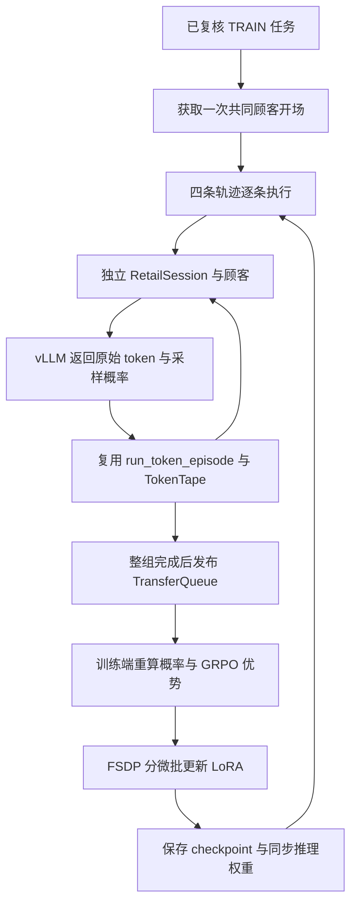

# Retail → verl：实现、阅读入口与验收

更新：2026-10-18。当前状态为**迁移代码与本地验证**。未启动服务器、顾客 API 或 CUDA 训练；不代表已经解决真实 OOM。

## 1. 已确认的设计

- 新增独立 verl 入口，保留原 TRL/NF4/FP32 训练路径和原 0.05 门槛。
- 新路径使用 Qwen3-4B、现有 SFT LoRA、BF16 底座/执行、vLLM 采样、verl V1 同步 GRPO。
- 现有 LoRA 为 rank 16、alpha 32、q/k/v/o 投影。实际 checkpoint 的 LoRA dtype 由审计记录，不声称所有参数都为 BF16。
- 组大小 4、温度 0.8、原奖励 A、完整轨迹上限 16384、每动作最多 512 token、最多 24 个动作。
- 使用 `seq-mean-token-mean`，保持轨迹等权；不增加 KL、Critic、Reference 模型或自动 dev/test 评估。
- 新路径记录采样/重算 logprob 偏差，不复制最大差超过 0.05 就停止的规则。结构错误和非有限值仍停止。
- 本轮迁移按用户授权不设固定费用上限，优先减少消耗，单独记账；不重置或改写历史预算。

## 2. 从哪里读代码

建议按下表顺序，先读 Retail，再打开对应的 verl 函数。

| Retail 文件/函数 | 职责 | 对应 verl 机制 |
| --- | --- | --- |
| `train_verl.py::preflight/build_config` | 冻结源码、检查任务和 SFT 起点、组合配置 | `trainer/main_ppo.py`、Hydra 配置 |
| `verl_runtime.py::RetailDataset` | 只给调度器公开 prompt 和任务 ID | 自定义 Dataset |
| `verl_runtime.py::RetailGroupWorker._run_group` | 一次开场、四条独立轨迹、整组发布或中止 | V1 AgentLoopWorker/TransferQueue |
| `verl_agent_loop.py::ServerSampler.generate` | 同步业务循环请求异步推理客户端 | LLMServerClient.generate |
| `verl_runtime.py::RetailAgentLoop.run` | 将现有 episode 转为 AgentLoopOutput | AgentLoopBase/AgentLoopOutput |
| 现有 `grpo_rollout.py::run_token_episode/TokenTape` | 工具、顾客、业务状态、原始 token 和 mask | 多轮 AgentLoop 的环境适配 |
| `verl_runtime.py::RetailPPOTrainer` | 记录阶段和概率指标，调用原生训练 | PPOTrainerSync |
| `audit_verl.py` | 单卡 LoRA checkpoint 导出、更新审计和独立重载 | verl 原生 checkpoint 产物 |



第一版刻意低并发：四条采样仍逐条推进，`max_num_seqs=1`、一个 AgentLoop worker。迁移成果是职责分离与显存机制接入，不据此宣称已经获得并行吞吐收益。

## 3. 显存优化实际落在哪里

### 分块词表投影

`model.use_fused_kernels=true`，后端为 `torch`。调用链为：

```text
FSDPEngine.prepare_model_inputs/prepare_model_outputs
  → models/transformers/dense_common.py::forward_with_torch_backend
  → utils/experimental/torch_functional.py::FusedLinearForPPO
  → FusedLinearForPPOFunction.forward/backward
```

该实现默认按 512 个位置投影到词表，输出目标 token 的 logp；反向逐块重算。相比先生成整段 `[C,V]` logits，目标是降低词表中间结果的峰值。反向仍有临时矩阵，并非零开销，也没有免除整个 Transformer 的激活成本。

### 其他措施

- 梯度检查点：用重算降低激活驻留。
- 去 padding：减少无效位置，不删除真实的顾客/工具反馈。
- 每条轨迹一个训练 micro-batch：四条轨迹累积后更新，分母保持整批轨迹数。
- CPU 参数/优化器卸载：降低不同阶段的 GPU 驻留，可能降低速度并增加 CPU 内存需求。
- 推理端 eager、小并发、chunked prefill、释放 cache：优先减少初始显存压力。
- 推理导出时合并 LoRA，便于完整休眠；训练端仍保留独立 LoRA。合并有 BF16 舍入差异，不把它称作逐位等价。
- LoRA-only checkpoint：保留优化器和额外状态，避免每步重复保存整个底座。

单卡 FSDP 不提供多卡分片的容量收益。24G 能否运行取决于底座、推理副本、KV、激活和临时结果的综合峰值。BF16 底座比旧 NF4 大，最终必须实测。

`gpu_memory_utilization=0.55` 是候选执行器预算比例，包含权重/激活/KV，而不是单独的 KV 限额，见 [vLLM 参数说明](https://docs.vllm.ai/en/v0.29.0/configuration/engine_args/#gpu-memory-utilization)。按本地模型配置（36 层、8 个 KV heads、head_dim 128、BF16）估算，单条 16384-token 轨迹的纯 KV 数据约 2.25 GiB，尚不包含权重、工作区和页管理。不能为了“省显存”把执行器比例压到连完整上下文都容纳不下；最终以 vLLM 初始化的 cache 容量和校准实测为准。

## 4. 业务语义与失败处理

同组共享开场，四条轨迹各自创建数据库和顾客。`ServerSampler` 在工作线程中把请求提交给主事件循环，现有业务循环无需重写为另一套状态机。

客服原始采样 token 直接追加，mask=1；工具和顾客反馈追加到上下文，mask=0。mask=0 代表没有直接策略损失，后续动作依然通过这些上下文计算。

只有四条轨迹全部通过后才发布整组。基础设施故障抛给同步调用者，不让默认 ReplayBuffer 把失败残缺组补齐后更新，也不自动补采。正常业务失败仍按原奖励处理。

每个动作完成后立即记录原始 token、采样概率、权重版本和反馈事件；顾客服务在中途失败时，已采到的 token 仍有日志，不必重新付费才能拿到失败前缀。

首个验收组若奖励全相同，会在发布/更新前停止并保留轨迹。后续同分组允许合法零梯度。梯度非有限时不能验收有效更新。

## 5. 概率和损失边界

保留真实 `rollout_log_probs`、重算 `old_log_probs` 和当前策略概率。记录绝对 logprob 差的 max/mean/p95、超过 0.05 的数量；这里的 0.05 只是诊断计数线。

verl 自带 `training/rollout_probs_diff_*` 的本地实现先对 logprob 取 exp，统计概率绝对差，不能与本项目的 logprob 差指标直接混用。

重要性修正和拒绝采样默认关闭。是否启用由后续固定权重/轨迹检查决定，不能用来掩盖 token、温度、mask 或适配器错误。

损失聚合与原 TRL 轨迹等权语义对齐。额外 dual-clip 使用高于本版本 ratio 上界的有限值使其不生效，避免无穷值带来的 `0*inf`。优势归一化 epsilon、极端 log-ratio 数值保护等仍有框架差异，因此不声称完整数学实现逐位相同。

同步版本号：初始化权重版本为 0；训练步 1 使用版本 0；步末同步版本 1；训练步 2 使用版本 1。版本记录用于发现陈旧采样，不能单独替代权重同步日志和参数审计。

## 6. 独立环境和启动

必须上传完整的 Retail 项目和当前 verl 源码目录。`configs/verl/source_lock.json` 冻结 `verl/` 下 Python/YAML、pyproject.toml 和 uv.lock 的内容指纹，没有编造 Git commit。源文件改变会被预检拒绝。

Linux CUDA 环境准备，不启动训练：

```bash
cd /root/autodl-tmp/retail-agent-rl
bash scripts/setup_verl.sh /root/autodl-tmp/verl-main
```

该脚本用 verl 的冻结 uv.lock 创建独立 `.venv-verl`，再安装 Retail 的轻量环境依赖和本项目。旧 `.venv-train` 保留。不要把旧 Torch/Transformers/TRL 依赖覆盖到新环境。

注意：本地快照锁使用 Torch 2.13.0、vLLM 0.29.0、Transformers 5.12.1 等；依赖安装、CUDA/驱动和 wheel 可用性尚未在目标服务器验证。若安装失败应保留错误，不能静默切到别的 verl 或后端版本。`uv pip check` 不通过时停止。

只读检查：

```bash
.venv-verl/bin/python -m retail_agent.train_verl --preflight \
  --verl-root /root/autodl-tmp/verl-main

.venv-verl/bin/python -m retail_agent.train_verl --dry-run \
  --verl-root /root/autodl-tmp/verl-main
```

必须使用本项目 `train_verl` 入口，它选择了自定义 TaskRunner 和组调度器；只向原生 `main_ppo` 传这份 YAML 不会自动完成 Retail 接入。

固定轨迹测试通过后，先做一次真实后端校准。它会产生顾客 API/GPU 消耗，但不更新参数、不保存训练 checkpoint、不执行步末权重同步：

```bash
CUDA_VISIBLE_DEVICES=0 .venv-verl/bin/python -m retail_agent.train_verl --calibrate \
  --verl-root /root/autodl-tmp/verl-main --task-id retail_301 \
  --output-dir outputs/verl/first_calibration
```

校准只允许一组。查看概率差异、长度和轨迹，确认没有接口错位后再启动更新；校准记录没有自动被判定为“偏差可接受”。

完成固定轨迹测试后，才使用新目录启动真实短程；示例任务属于 TRAIN，但不保证新 BF16 策略有组内奖励差异：

```bash
CUDA_VISIBLE_DEVICES=0 .venv-verl/bin/python -m retail_agent.train_verl --run \
  --verl-root /root/autodl-tmp/verl-main \
  --task-id retail_301 --task-id retail_527 --max-steps 2 \
  --output-dir outputs/verl/first_cuda_run
```

不覆盖现有目录、不自动恢复、不自动运行 94 步。默认开启首步非零梯度验收。

## 7. 固定轨迹显存对照与检查点

用同一份旧日志里的完整轨迹做两次独立进程测试，默认选最长轨迹；若指定 index，两次必须一致：

```bash
CUDA_VISIBLE_DEVICES=0 .venv-verl/bin/python -m retail_agent.profile_verl_memory \
  --trace-log /absolute/path/to/observations.jsonl --backend dense \
  --output-dir outputs/verl/probe_dense

CUDA_VISIBLE_DEVICES=0 .venv-verl/bin/python -m retail_agent.profile_verl_memory \
  --trace-log /absolute/path/to/observations.jsonl --backend fused \
  --output-dir outputs/verl/probe_fused
```

这是相同 BF16 底座、适配器、完整 token 和 mask 上的负对数似然反向探针：没有顾客 API，没有优化器更新，也没有生成假奖励。它能检查词表概率计算的显存变化，**不是完整 FSDP/vLLM GRPO 峰值**。旧 NF4 轨迹不用于新策略的 on-policy 更新。

比较 `probe.json` 的 trace/source/adapter 指纹、长度、峰值 allocated/reserved 和耗时；比较 `logps.pt` 数值。不能仅凭一边没有 OOM 就编造精确节省比例。

真实训练后，在新进程中审计：

```bash
CUDA_VISIBLE_DEVICES=0 .venv-verl/bin/python -m retail_agent.audit_verl \
  --checkpoint outputs/verl/first_cuda_run/checkpoints/global_step_2/actor \
  --output-dir outputs/verl/first_cuda_run/exported_adapter --reload-cuda
```

只支持本次单卡普通 Tensor checkpoint，不近似拼接多卡分片。对齐 dtype 后比较原 SFT，拒绝只有精度转换、没有真实参数变化的“有效更新”；检查优化器状态有限且有更新步。导出后独立加载，逐参数核对并执行有限前向。它不调用顾客 API、不执行优化器，不代表业务提升或精确断点续训已验收。

## 8. 产物与验证范围

每次真实运行保存：

- `config.yaml`、`train_tasks.jsonl`、`run.json`：源码/适配器/入口指纹、依赖、GPU、状态、API 记账上界和耗时。
- `observations/`：真实轨迹、组统计和异常；API 原始费用记录在 `customer_costs.jsonl`。
- `phases.jsonl`：采样、休眠、重算、更新、同步的时间边界。
- `gpu_memory.jsonl`：nvidia-smi 每秒采样的整卡占用；用于覆盖 vLLM 进程，但它是采样值，不保证捕捉精确峰值，也可能包含其他进程。
- 框架训练指标：训练进程的累计 PyTorch 峰值。不能把 reserved 当实际活跃张量，不能把累计峰值当每阶段独立峰值。
- `checkpoints/`、导出适配器和 `audit.json`。
- 训练或探针失败时的 `failure.txt`：保存完整异常栈，避免下一次只剩“发生过 OOM”的描述。

API 费用由原顾客客户端的计价函数估算，不替代官方账单；GPU 实付需要结合服务器账单核对，代码不编造 GPU 单价。

本地测试覆盖真实 Retail/tokenizer 与原 episode 的 token、mask、奖励对照；真实 verl 分块函数前向/反向；小 Qwen3 LoRA 梯度；原生策略损失的微批归一化和零优势；数据来源保护、失败传播、原生输出 schema、配置和检查点审计。

本地没有完整 Ray/TransferQueue/vLLM CUDA 运行环境。部分进程边界使用替身；TensorDict 和 Pydantic 序列化另做真实库检查。小模型数值检查使用现有本地 Torch/Transformers，并非目标 GPU 锁环境。检查结果不能冒充 4B/CUDA 训练。

## 9. 向老师汇报的顺序

1. 展示原路径的 `[C,V]` logits 和显存组成，解释为什么 4-bit 权重不保证长轨迹可训练。
2. 展示 `AgentLoop → TransferQueue → old_logp/advantage → actor update → weight sync`。
3. 展示本项目如何保留共享开场、独立数据库、真实 token、动作 mask 和环境奖励。
4. 展示分块前向/反向源码及本地概率、梯度对照；说明轨迹等权与 token 等权的区别。
5. 有 GPU 数据时再展示显存与真实更新证据；没有时明确 CUDA 待验收，不宣称 OOM 已解决或业务能力提升。

可直接使用的进度表述：

> 我沿 verl 的同步 GRPO 调用链，完成了 Retail 多轮环境适配，并接入分块词表概率计算、微批训练、卸载和采样阶段切换的配置。本地验证覆盖 token/mask、业务奖励、概率和梯度对照。下一步是在同条件固定轨迹上测显存，再验证真实参数更新、权重同步和检查点重载。
